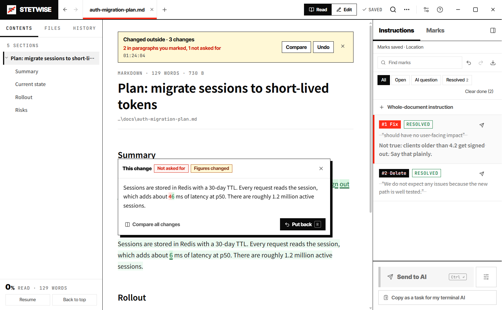
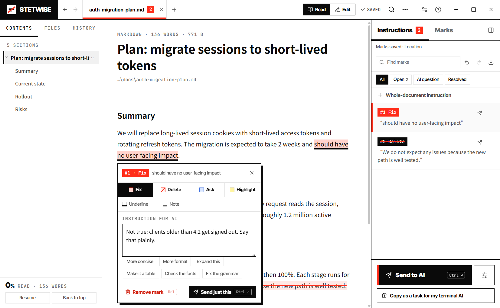
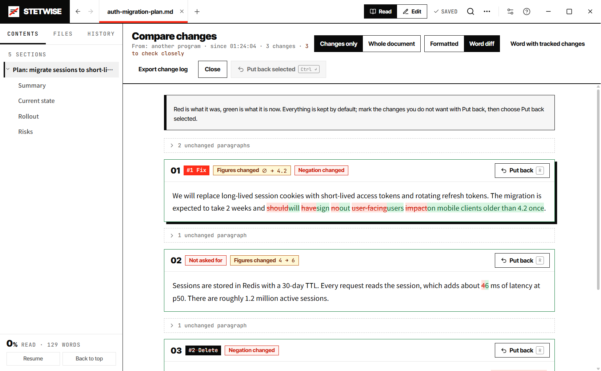

# Stetwise

**See exactly what your AI changed in a Markdown file, including what it changed without being asked.**

Stetwise is a local desktop app for documents written or edited by AI command-line tools (Claude Code, Codex, Gemini CLI and others). Keep it open beside your terminal: when the AI edits a file, Stetwise shows every changed word and points out the changes in paragraphs you never marked.

[中文说明](#中文说明) · [Install](#install) · [With the AI in your terminal](#with-the-ai-in-your-terminal) · [Features](#features) · [CLI not detected?](#cli-not-detected) · [License](#许可--license)



## What it does

- **It follows the file.** When an AI in your terminal saves the file, the new text appears at once and the words it changed stay marked in the text. Click one to see what it replaced and put just that change back, or compare and undo the whole round.
- **It checks the changes against what you asked for.** Mark passages and write a short instruction on each. When the changes arrive, Stetwise says how many are in paragraphs you marked and how many are not, and flags changed figures, negations, links and names.
- **It gets your instructions to the AI you already have open.** Copy them as a task and paste it into the terminal. Or let the AI ask: `stetwise-review plan.md` opens the file, waits while you mark it up, and prints your instructions.
- **Or it runs the AI for you.** Send the instructions to one of twelve AI CLIs installed on your machine. The AI edits a copy in which your selections are wrapped in anchors; anything it changes outside them is set aside, and nothing is written to your file until you accept it.
- **It stays on your computer.** Documents, marks and settings are local files. No account and no API key: Stetwise uses the CLIs you are already signed in to.



## Install

Stetwise does not publish installers. Give this repository to your AI assistant and ask it to build and install Stetwise. It follows [AGENTS.md](AGENTS.md) on your machine, which takes a few minutes and needs Node.js 22 or newer. Building it this way also shows that your AI CLI works on this machine.

- Windows 10 / 11 (x64, arm64) and macOS (Apple Silicon, Intel). Linux runs from source with `npm run desktop`.
- The builds are not code-signed. Windows: choose **More info → Run anyway**. macOS: open **System Settings → Privacy & Security** and choose **Open Anyway**.
- AI assistants: build from source as [AGENTS.md](AGENTS.md) describes. There is no download to look for.

## With the AI in your terminal

1. Open the Markdown file in Stetwise.
2. Select text and press `F` (fix), `D` (delete) or `Q` (ask). Write what you want in a sentence: tighten it, expand it, make it a table, check the figures.
3. Click **Copy as a task for my terminal AI** and paste it into Claude Code, Codex or whichever AI you have running. It edits the file directly, with everything it already knows from your conversation.
4. As the AI saves, Stetwise marks what changed in the text and says how many changes are in paragraphs you marked. Click a change to see what it replaced and **Put back** the ones you do not want; **Compare** lists them all next to the instruction each belongs to.



To let the AI ask for a review on its own, press `Ctrl K`, choose **Copy the review command for my terminal AI**, and paste the text into your `CLAUDE.md` or `AGENTS.md`. For Claude Code there is also a ready-made skill in [integrations/claude-code/stetwise-review](integrations/claude-code/stetwise-review/SKILL.md). The command comes with the installed app, not the portable build.

If you would rather not keep a terminal open, **Send to AI** (`Ctrl Enter`) starts a CLI for you and opens a review when it finishes: keep or put back each change, then the result is written to your file.

## Features

- **Interface.** English by default; switch to Chinese under Settings (top right).
- **Reading.** Markdown, TXT, HTML and DOCX (native Word charts keep their data). Math (KaTeX), Mermaid diagrams, charts drawn from plain Markdown tables, code highlighting, footnotes, an outline, search, side-by-side reading, light, dark and sepia themes. English text is set ragged-right and Chinese justified.
- **Long documents.** Documents over 30,000 characters are drawn in parts as you scroll; in a test, a 20-million-character file opened in about one second. A table or code block too large for one part is drawn in pieces that join up.
- **Marks.** Instructions for the AI (`F` fix, `D` delete, `Q` ask, and whole-document instructions; a Fix carries any instruction, and `E` / `I` start one too) and marks for yourself (`H` highlight, `U` underline, `N` note). They are stored beside your data, never in the document.
- **Sending.** Twelve CLI adapters (Claude Code, Codex CLI, Gemini CLI, Qwen Code, Kimi CLI, iFlow CLI, CodeBuddy Code, Qoder CLI, opencode, Cursor CLI, Copilot CLI, Aider) plus custom commands. Detection runs each tool for real. After the first time, `Ctrl Enter` goes straight to the AI you used last.
- **The task the AI gets.** It carries what happened in the last round on the document, so the AI does not make again a change you put back. It is told to read the whole document first, to change only the text between its anchors, to ask instead of guessing, and not to invent figures or sources. Hidden content the AI would read (comments, invisible characters, instruction-like text) is listed before you send.
- **Review.** Each change on its own, word by word: keep it, put it back, or edit it. Put one back with a sentence and that sentence becomes the next instruction. A review survives closing the window.
- **History.** A version is saved before every AI edit and every outside change; any version can be compared with the present and partly or wholly restored.
- **Export.** Markdown, PDF, Word (with tracked changes and comments if you want), a change log, and formatted text for chat and mail.
- **Automation.** A page API and a JSON Lines session for scripts: [docs/AI_API.md](docs/AI_API.md).

## CLI not detected?

Ask your own AI, in the terminal where you normally use it, for the full path of its executable and a command that runs it without prompts. Then enter the path or a custom command under **More → AI tools**. The Chinese section below has a prompt you can paste (it works in English too).

Stetwise was formerly called Proofline. Upgrading keeps your marks, settings and data folder, and the old repository address redirects here.

---

## 中文说明

**看清 AI 到底改了你文档的哪些字，包括你没让它改的地方。** 标出要改的地方，交给你电脑上的命令行 AI，逐处审阅后才写回。

> 当前版本 0.5.0。**怎么安装**：把这个仓库地址发给你常用的 AI（Claude Code、Codex、Gemini CLI 等），对它说「帮我打包安装 Stetwise」，它会按 [AGENTS.md](AGENTS.md) 在你的电脑上打好安装包，大约几分钟。本项目不提供现成的安装包。
>
> Stetwise 原名 Proofline。升级安装会自动沿用原来的标记、设置、阅读记录和数据目录（`ProoflineData` 会改名为 `StetwiseData`）；旧仓库地址会自动跳转到这里。

[功能一览](#功能一览) · [平台支持](#平台支持) · [没检测到 CLI？](#没检测到我的-cli怎么办) · [参与共建](CONTRIBUTING.md) · [许可](#许可--license)

## 这是什么

AI 写得越来越多，人读得越来越累。Stetwise 让你像批改作文一样审 AI 的文档：在正文里划出要改的地方，写一句要求，交给你电脑上已经登录的 Claude Code、Codex、Gemini 等命令行 AI。改完后每一处修改单独列出，你逐个保留或改回，确认后才写回原文件。

- **本地优先**：文档、标记和设置都在你的电脑上；发给 AI 的内容由你自己的 CLI 和它已配置的模型服务处理。
- **不需要 API key**：直接使用你本机 CLI 已经登录的账号。
- **不怕改坏**：AI 默认在副本上修改；审阅完成之前，原文件一个字都不会变；每次 AI 修改前自动存一个版本。

### 项目简介（可直接引用）

- **一句话**：Stetwise — 标出 AI 写的文档哪里要改，一键交给本机 AI，逐处审阅后才写回。
- **One line**: Mark up AI-written Markdown, hand the fixes to your local AI CLI, and review every change before it touches your file.
- **产品向**：AI 写得越来越多，人读得越来越累。Stetwise 让你像批改作文一样：划出来、写一句要求、交给 Claude Code / Codex / Gemini，改完逐处保留或改回。
- **开发者向**：本地优先的 Markdown 审阅工作台。批注存为本机 JSON，任务交给已登录的 AI 命令行工具，按段落比较差异后写回，不需要 API key。

---

## 功能一览

### 阅读

- **支持格式**：Markdown（`.md` `.markdown` `.mdown` `.mkd`）、纯文本 `.txt`，以及 HTML（`.html` `.htm`）和 Word（`.docx`）。HTML 和 Word 会转成 Markdown 阅读和编辑，另存为新文件。**Word 里的原生图表**（柱状、条形、折线、面积、饼图、环形、雷达、散点）会连同数据一起变成 Stetwise 图表，留在原来的位置；组合图、3D 图等会简化显示并注明，数据完整保留。
- **长文排版**：16px 正文、1.85 行距、680px 阅读宽度，标题层级清晰。可调阅读宽度（窄 / 适中 / 宽）、代码字号和侧栏宽度。
- **超长文档不卡**：超过 3 万字自动分块渐进渲染，滚动、查找、跳转都不卡。超大的表格和代码块会分段显示并拼成一整块；流程图等滚动停下后再画，不拖慢滚动。
- **中英文排版**：中文两端对齐，英文左对齐，按文档自动判断。
- **公式**：KaTeX 渲染行内公式 `$…$`、`\(…\)` 和块级公式 `$$…$$`、`\[…\]`，支持 aligned、矩阵、分段函数、根号、极限等。价格里的 `$5` 不会被误当成公式。
- **图表**：柱状（并排 / 堆叠 / 横向）、折线、面积、饼图、环形、雷达、散点。数据就是一张普通 Markdown 表格，上面加一行隐藏标记 `<!-- stetwise:chart type=bar title="…" -->`：在别的软件里显示成表格，数据不会丢；在 Stetwise 里显示成图表，悬停看数值，可切换到数据表。Mermaid 流程图、饼图等在阅读时也会直接画出来。
- **表格**：点表头排序（只改变显示顺序，不改文档）；数字列自动显示合计和平均，可一键「插入为合计行」写进文档。
- **文档统计**：更多 → 文档统计，显示字数、字符、阅读时长、标题 / 段落 / 表格 / 图表 / 图片 / 公式数量，以及各类指令的完成情况。
- **代码与其他**：代码高亮、任务列表、脚注、定义列表。
- **中文排版**：中文标点旁边的 `**加粗**` 能正确显示（标准 Markdown 在这里会失效）。
- **目录与进度**：左侧自动生成目录，显示阅读百分比；记住每篇文档的阅读位置，可以返回上次位置。
- **查找**：在当前文档中查找（`Ctrl F`），阅读和编辑模式下都会高亮并跳到对应位置；在打开的文件夹里查找文档（`Ctrl P`）。
- **并排阅读**：右侧打开另一篇参考文档，支持同步滚动和左右交换。
- **文件夹工作区**：打开一个文件夹，浏览其中的 Markdown 和 TXT 文件。
- **图片**：本地图片按阅读位置按需加载，点击可放大查看。
- **按路径打开**：`Ctrl L` 直接输入路径打开文件。
- **标签页**：同时打开多篇文档，可以重新打开刚关闭的文档。
- **外观**：浅色 / 深色 / 跟随系统；正文可选白色或护眼米色底。
- **命令面板**：`Ctrl K` 搜索并执行任何操作，快捷键也显示在里面。
- **中英双语界面**：默认英文，在右上角「设置」里切换。

### 标记（选中文字后弹出工具条，也可以右键）

| 类型 | 快捷键 | 用途 | 会发给 AI 吗 |
| --- | --- | --- | --- |
| 修改 | `F` | 写一句要求让 AI 改这里，例如「更简洁」「展开写」「改成表格」「核对数据」 | 会 |
| 删除 | `D` | 让 AI 删掉这段 | 会 |
| 提问 | `Q` | 问 AI 问题，不改文档 | 会（回答显示在标记里） |
| 高亮 | `H` | 自己的记号 | 不会 |
| 划线 | `U` | 自己的记号 | 不会 |
| 批注 | `N` | 自己的笔记 | 不会 |

- 「修改」可以承载任何要求，所以给 AI 的只有修改、删除、提问三种。按 `E` 会新建一条已写好「展开写」的修改，`I` 也新建修改；以前标的「展开」「自由指令」照常保留和发送。
- 跨行、跨段、跨列表项选择都可以标；拖到文末之外也能识别。
- **全文指令**：不用选文字，在右侧「指令」栏点「全文指令」，直接对整篇下一条要求，例如「全文改成正式语气」。
- **对图表下指令**：点图表右上角「对图表下指令」，整张图表的数据会被选中，写一句要求即可，例如「Q3 门店改成 66」。
- 点正文里的任何标记，都可以改类型、写要求或移除；移除后可以撤销。标记操作也有撤销 / 重做。
- 右侧面板分「指令」和「标记」两栏，按位置排列，可以搜索、筛选、跳转、单条发送，也可以导出全部标记为 JSON。
- 写要求时有常用短语可以一键填入（更简洁、补充数据、改成表格……），`Ctrl Enter` 只发这一条。
- 「指令」栏可以按待处理 / AI 有疑问 / 已处理筛选，已处理的一键清理（可撤销）。同一段文字重复标同一种指令时，会直接打开已有的那条。
- `Del` 删除当前标记，`Ctrl Enter` 发送全部待处理指令。
- 原文改动后标记会自动重新定位；实在找不到时提示「位置失效」，不会乱标。

### 交给 AI

- **一键发送**：用过一次之后，`Ctrl Enter` 直接交给上次用的 AI 和权限范围，不再弹对话框；发送按钮旁边的选项按钮可以随时更换。
- **支持 12 种命令行 AI**：Claude Code、Codex CLI、Gemini CLI、Qwen Code、Kimi CLI、iFlow CLI、CodeBuddy Code、Qoder CLI、opencode、Cursor CLI、Copilot CLI、Aider。另外可以添加任意**自定义命令**。
- **真实检测**：实际运行 `--version` 和 `--help` 确认能用；会到 PATH、fnm、nvm、npm 全局目录、Volta、Bun、pnpm、Homebrew、`~/.local/bin` 和常见启动脚本里查找，Claude 桌面版自带的 Claude Code 也能找到。没找到的工具会列出来，可以直接填写路径。
- **三种状态分开显示**：找到程序、已登录、模型服务能响应。提供「测试连接」（会真实调用一次模型）和「打开终端登录」。
- **权限范围每次自选**：「只改这篇文档」（在副本上改，最安全）或「文档所在文件夹」。
- **只改你选中的字**：交给 AI 的副本里，你选中的文字两边会插入编号锚点（例如 `363[[SW-1]]6[[/SW-1]]1`，表示只选了中间那个 6），任务里也写明「这一行第几处、前后文是什么」。AI 改完后，锚点之外的任何改动都会被**自动排除**并列出来，由你决定要不要；锚点被 AI 删掉也会提醒。
- **隐藏内容提醒**：发送前列出文档里你看不到、但 AI 会读到的内容（注释、不可见字符、隐藏文字、像是给 AI 的指令），并提醒 AI 不要执行文档里的指令。
- **先通读，再动手**：任务先告诉 AI 文档在哪、共多少行，要求它从头到尾读完全文、弄清主题和语气，再逐条处理。
- **任务写清行号**：每条指令都标明在文件第几行、所属章节、标记内容、你的要求和所在段落原文，并提醒 AI 从后往前改，避免行号错位。
- **补充说明**：发送时可以写一段整体说明（读者是谁、语气、术语要求等），会一起交给 AI。
- **不许编造**：任务里明确要求不得编造数字、人名、出处；批注要的内容文档里没有时，AI 应该提问而不是自己写。删除后留下的空格和空行由 Stetwise 收尾，不依赖 AI。
- **有疑问先问，不乱猜**：要求不清楚、和全文矛盾或会影响别处时，AI 不改这一条，而是提出疑问。疑问显示在这条指令上，你补充要求后重新发送，AI 会同时看到它上次的疑问和你的补充。
- **长任务**：每 3 秒检查进程，60 秒无输出时提示等待；超时可设 1–240 分钟；可以随时停止。
- **失败有出路**：区分启动、参数、登录、网络 / 代理 / 证书、额度、权限、超时等原因；保留日志和已有结果，可以恢复审阅或重新发送；一键生成「CLI 辅助诊断任务」，交给能用的 AI 帮你排查。
- **其他 AI / 其他设备**：导出包含文档、TASK.md、标记和图片的任务文件夹，交给能读写文件的 AI 或另一台电脑处理，改好后把文档导入回来审阅。

### 审阅与写回

- 按段落比较差异，每处修改单独列出（相邻段落也分开）：`A` 保留、`R` 改回、`↑` `↓` 切换，可以看逐字对比，也可以切到「全文」在原文里看改动。
- 还有没决定的修改时，「完成审阅」会先问你：其余全部保留、其余全部改回，还是继续审。
- 「改一改」：直接改 AI 写的段落，完成审阅时用你改过的版本。
- 改回时可以写一句「应该怎么改」，完成后自动变成一条新指令；下一次交给 AI 时，任务里也会带上上一轮改了什么、你保留了哪些、改回了哪些，AI 不会把你改回的再改一遍；AI 提出的疑问可以在审阅页里直接回答，再一键「接着发给 AI」。
- 审到一半关掉窗口也没关系，下次打开文档可以接着审。
- **重点提醒**：改了数字、否定词（不 / 没有）、链接、引用或人名的地方会单独标出来，提醒你仔细核对。
- 提问类指令的回答、AI 提出的疑问，都显示在审阅页右侧和对应的指令上。
- 审阅完成才写回；AI 修改前自动保存一个版本。写回后页面顶部有「对比」和「撤销」，阅读模式下也能整轮撤销。
- AI 运行时可以看每条指令的进度，随时「预览当前结果」；完成时如果窗口不在前台，会弹系统通知。运行期间你改了文档，AI 的修改会合并到你的最新版本上。
- **外部修改自动跟随**：别的 AI（例如终端里的 Claude Code、Codex）直接改文件时，只要你这里没有未保存的修改，Stetwise 会立即显示新内容，并在正文里标出改动的词；点一下就能看到原来写的是什么，只改回这一处。顶部显示「被外部修改了 · N 处」，可以「对比」逐处改回，或「撤销」整轮。你这里也有没保存的修改时，才需要「对比并合并」。
- **按你的标记核对**：外部修改到达时，Stetwise 会对照你标过的指令，告诉你「几处在你标记的段落里，几处没让改」；对比页里没让改的地方有红色标签。
- **历史版本**：左侧「历史」列出每次保存、AI 写回和外部修改，每个版本都可以和现在对比，只改回选中的几处，或整篇恢复；未写回的内容有恢复草稿。

### 和终端里的 AI 配合

不想让 Stetwise 另起一个 AI，而是用你已经开着的那个（它记得你们聊过的上下文）：

- **复制成任务**：在右侧点「复制成任务，贴给终端里的 AI」，把待处理的指令连同文件完整路径复制成一段文字，贴给 Claude Code、Codex 等。它直接改文件，改动显示在 Stetwise 里并按标记核对。
- **让 AI 主动请你审**：安装版自带 `stetwise-review` 命令。AI 运行 `stetwise-review 文档.md` 后，Stetwise 打开这篇文档并在顶部提示「终端里的 AI 在等你审」；你标好之后点「把指令发回终端」，命令就把你的指令输出给 AI。`Ctrl K` 里的「复制「请我审」的命令」可以得到完整的命令行，贴进你的 `CLAUDE.md` 或 `AGENTS.md` 即可。Claude Code 还可以直接用 [integrations/claude-code/stetwise-review](integrations/claude-code/stetwise-review/SKILL.md) 这个技能。便携版没有这个命令。

### 编辑

- 所见即所得编辑（Milkdown）：工具栏提供标题、加粗、列表、引用、表格、链接、图片、代码块、公式；输入 `/` 也能插入，还能插入各种图表和带合计的统计表。
- **只重写你改动的段落**，其余段落保持原有的 Markdown 写法。
- 长文档按章节分段编辑，打字不卡。
- 可以切换查看 Markdown 源文件。
- 粘贴或插入的图片会真正保存到「文档名.md.assets」文件夹，Markdown 里使用相对路径。

### 导出与数据

- 导出 Markdown、保存 PDF（中文字体内嵌，可选 A4 / Letter 和页码）、**导出 Word（.docx）**：标题、列表、引用、表格、代码、链接、图片都会保留；图表和 Mermaid 图导出为清晰图片，下方附数据表；公式保留原始写法。
- **导出带修订的 Word**：把最近一次 AI 或外部修改写成 Word 修订，对方在 Word 里逐条接受或拒绝；指令、处理状态和 AI 的回答写成批注。
- **导出修改记录**：每处改动的前后对比，加上全部指令和 AI 的回答，方便发给同事或存档。
- **复制为富文本**：直接粘贴到飞书、钉钉、企业微信、Notion 或邮件，格式不丢。
- 导出默认保存在文档旁边，完成后可以「在文件夹中显示」。
- 标记和设置保存为 JSON：默认在安装目录的 `StetwiseData`，便携版在程序旁边，Mac 在 `Stetwise.app` 旁边。使用原子写入并保留上一份 `.bak`。
- 安装目录不可写（例如装在 Program Files）时，自动改存到用户数据目录并提示。也可以在设置里迁移到别的位置。
- **升级和卸载都会保留数据。**
- 换电脑时复制 `StetwiseData`、文档和 `.assets` 文件夹即可；同名同内容的文档会自动重新关联标记。

### 安装

- **让你的 AI 帮你打包**：把仓库地址 `https://github.com/yk-hello/stetwise` 发给你常用的 AI，说「帮我打包安装 Stetwise」。它会按 [AGENTS.md](AGENTS.md) 检查环境、打包、校验，然后告诉你安装包在哪里。Windows 得到安装版和便携版，Mac 得到 DMG。
- 安装包没有代码签名：Windows 首次运行点「更多信息 → 仍要运行」；Mac 首次打开在「系统设置 → 隐私与安全性」里点「仍要打开」。
- 安装向导默认勾选：设为 Markdown / TXT 的默认打开方式、创建桌面快捷方式、固定到任务栏。
- 首次启动有设置向导：检测默认应用和任务栏状态，列出本机能用的命令行 AI。Windows 11 不允许程序自己抢默认应用或固定任务栏，向导会带你点一下完成。
- 另有便携版：不用安装，数据放在程序旁边。

### 自动化接口

页面 API `window.stetwiseReader` 和 JSON Lines 命令行会话，方便脚本和 AI 操作阅读器。详见 [docs/AI_API.md](docs/AI_API.md)。

---

## 平台支持

- **Windows 10 / 11**：x64 和 arm64，安装版和便携版。
- **macOS**：Apple Silicon 和 Intel，DMG 和 ZIP。
- **Linux**：暂不提供安装包，可以用 `npm run desktop` 从源码运行。

本项目不提供现成安装包，请按 [AGENTS.md](AGENTS.md) 在自己的电脑上打包。安装包没有代码签名，首次运行的处理方法见上面的「安装」。

---

## 使用

1. 安装后打开 Markdown 或 TXT（可以直接双击文件）。
2. 选中文字，选择修改 / 删除 / 提问（快捷键 F、D、Q），写一句要求。
3. 在右侧点「交给 AI 修改」（`Ctrl Enter`），选择本机的命令行 AI 和权限范围。
4. AI 改完后自动进入审阅页，逐处保留或改回，完成后写回原文件。

## 没检测到我的 CLI，怎么办？

Stetwise 会自动查找 12 种常见命令行 AI。如果你的工具装在不常见的位置、用启动脚本运行，或者不在内置列表里，**让你自己的 AI 帮你查**：

1. 打开你平时使用这个 AI 的终端，也就是你能正常和它对话的那个窗口。
2. 把下面这段话原样发给它：

~~~text
我要在 Stetwise（一个本地 Markdown 审阅软件）里调用你，以非交互方式修改文档。请在这台电脑上帮我查清楚，并且每一步都实际运行验证，不要猜：

1. 我现在启动你用的可执行文件或启动脚本的完整绝对路径（Windows 用 where / Get-Command，macOS 用 which / command -v；如果是 .cmd、.ps1、shell 脚本或 alias，请找到真正的入口文件）。
2. 用这个完整路径运行 --version，告诉我输出。
3. 用这个完整路径以非交互（headless / print / exec）方式运行一次：只回复 READY，不调用任何工具。告诉我实际用的完整命令和输出。
4. 在一个临时文件夹里新建 test.md，内容是 The cost is 10.；用非交互方式让你把 10 改成 20，期间不能停下来等我确认。改完后读一遍文件，确认确实变成了 20。
5. 把第 4 步验证成功的命令整理成一行模板，用 {prompt} 代表指令、{file} 代表文档路径、{dir} 代表工作目录。

最后只给我两样东西：可执行文件完整路径、命令模板。不要修改你的登录、模型或代理配置，不要显示任何密钥或 token。
~~~

3. 回到 Stetwise，打开 **更多 → AI 工具设置**：
   - **它在列表里**：展开它，把完整路径填进「路径」，保存后点「测试连接」。
   - **它不在列表里**：点「添加自定义命令」，名称随意，「命令模板」填它给你的那一行，保存。
4. 找到了但运行失败（没登录、网络、额度、参数不兼容）：在 AI 工具设置里点「生成 CLI 辅助诊断任务」，把生成的文件夹交给能正常使用的 AI，对它说「请阅读 TASK.md 和 diagnostics.json，按步骤排查 Stetwise 连接问题」。
5. 实在接不上：发送时选「其他 AI / 其他设备」，导出任务文件夹交给任何 AI 处理，再把改好的文档导入 Stetwise 审阅。

还是不行，可以用「[CLI 没检测到或不能用](../../issues/new/choose)」模板反馈，写清 CLI 名称、版本和安装方式。**不要贴密钥、token 或私人文档内容。**

无论用哪种方式，AI 都先改在副本上，你审阅完成后才会写回原文件。

---

## 开发

```sh
npm ci
npm run desktop:dev        # 桌面版，热更新
npm run desktop:pack       # Windows 安装版和便携版，输出到 release/
npm run desktop:pack:mac   # 必须在 Mac 上运行；签名和公证另行配置
```

打包的完整步骤（含镜像、常见错误）见 [AGENTS.md](AGENTS.md)。

需要 Node 22 或更高版本。代码结构和新增 CLI 适配的方法见 [CONTRIBUTING.md](CONTRIBUTING.md)。

## 许可 / License

- 代码采用 [Apache License 2.0](LICENSE)：可以自由使用、修改、再发布，包括商用。
- 版权所有 © 2026 Zhang YK（hello.yk.zhang@gmail.com），见 [NOTICE](NOTICE)。
- 「Stetwise」名称和图标不在代码许可范围内：发布修改版请换名换图标，详见 [TRADEMARKS.md](TRADEMARKS.md)。
- 欢迎在本仓库共建，提交方式见 [CONTRIBUTING.md](CONTRIBUTING.md)。第三方组件许可见 [THIRD_PARTY_NOTICES.md](THIRD_PARTY_NOTICES.md)。
