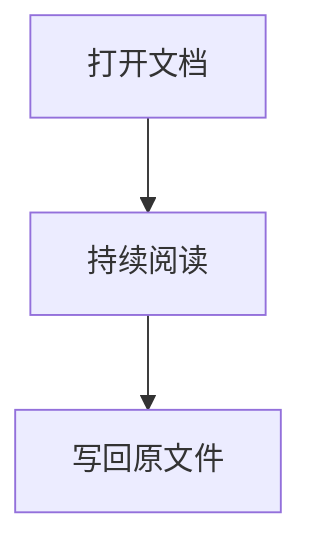

# 中文技术长文

这是用于验证 **Markdown**、公式 $E=mc^2$、表格、代码和中文排版的测试文档。

## 数据表

| 项目 | 说明 |
| --- | --- |
| 公式 | $a^2+b^2=c^2$ |
| 图片 | `assets/diagram.svg` |

## 代码

```js
const reader = await openDocument('中文技术长文.md');
```

## 流程图




- 第一层
  - 第二层
    - 第三层

> 文档应当稳定、清晰、可持续阅读。
